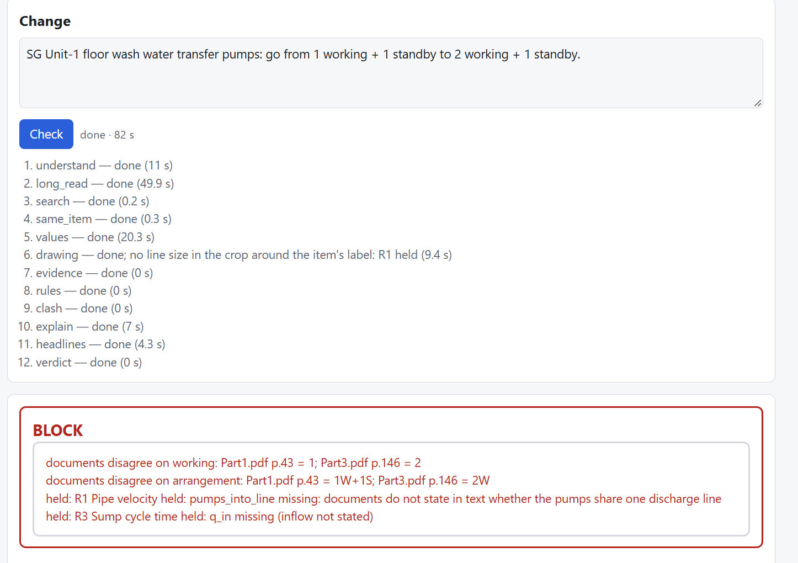
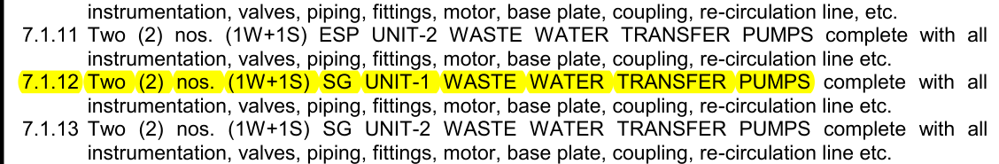
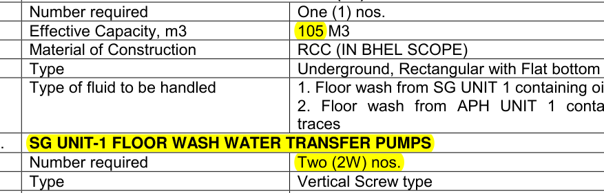
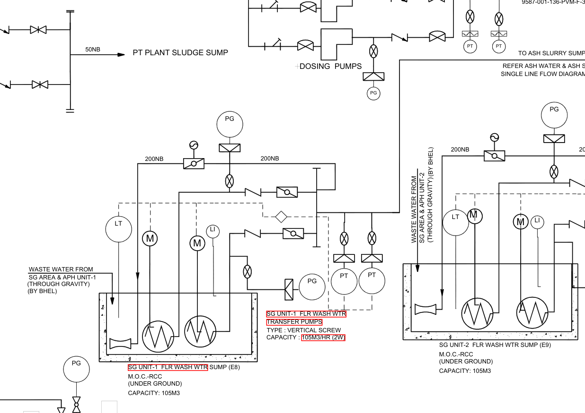
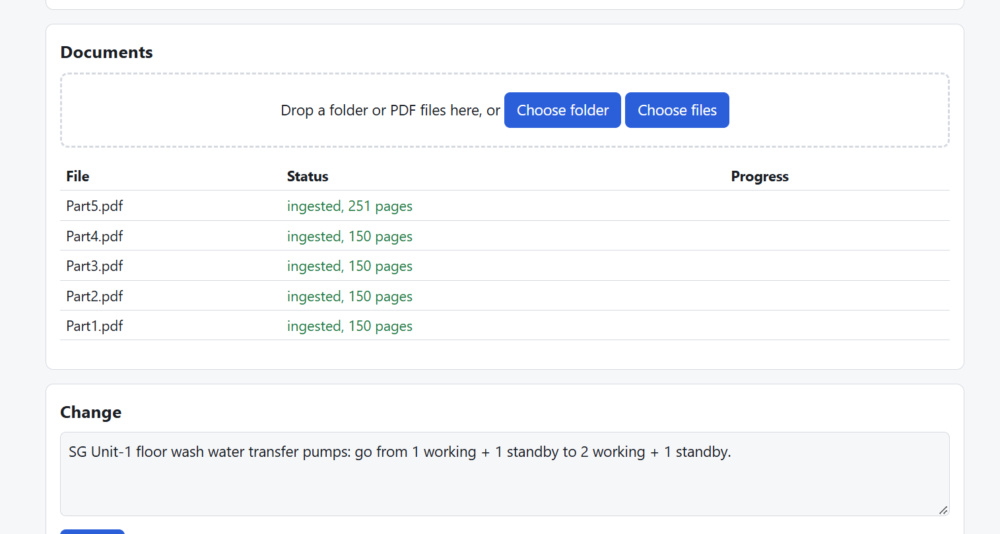
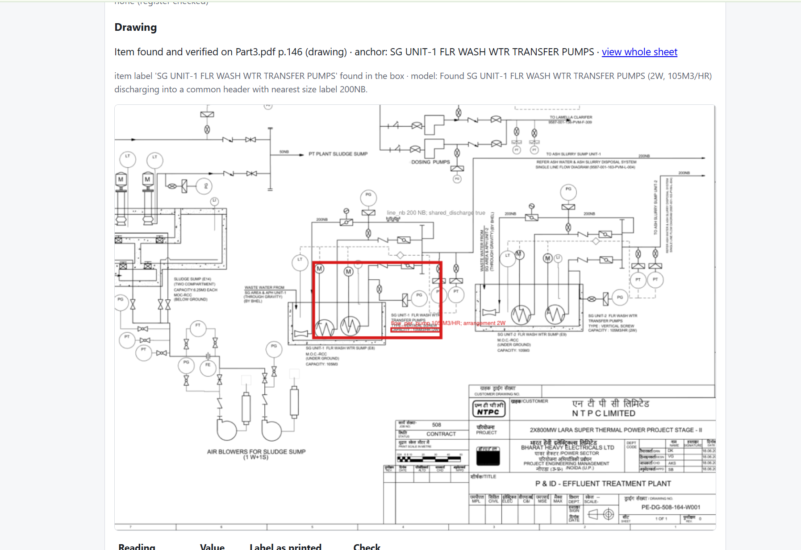
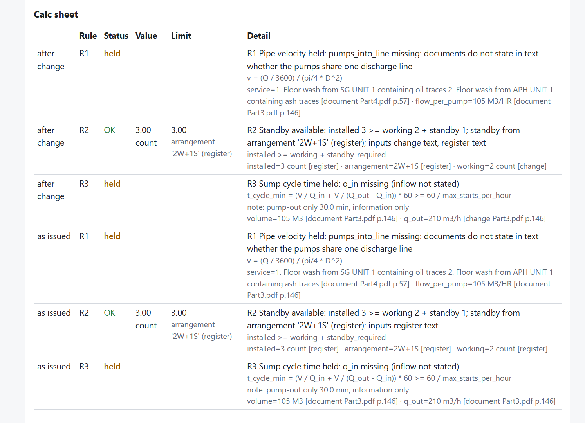
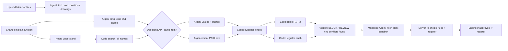

# Interlock

**No plant change is signed off until every document agrees, and the numbers still work.**

[**Live app**](https://interlock-67888742605.us-central1.run.app) · [**1-minute video**](https://youtu.be/XNRrCkPCmYc) · Built today at the Gemini 4 NYC Hackathon (21 Nov 2026) · Problem Statement One



---

## The problem

When a process plant wants to change something (run a second pump, resize a line, drop a spare), an engineer has to approve it first. This is management of change, and today it works like this:

- The plant's design lives in **hundreds of pages**: scope of supply, equipment data sheets, P&ID drawings, design-basis tables. One piece of equipment appears in many of them, often **under different names**.
- The engineer finds every page about that equipment **by hand**, checks the pages agree, then works out **by hand** what the change does to everything connected to it: the pipe, the spare pump, the sump.
- It takes **weeks per change** (2-4 weeks in the builder's experience of plant engineering reviews; experience, not a measurement), and errors still get through, because nobody can hold 851 pages in their head. A missed page means a pump with no spare, or a pipe running faster than the plant's own design basis allows.

Interlock does that check for one change at a time: it finds every page, proves each value against its page, runs the engineering math in code, shows the equipment on the drawing, and only then gives a verdict.

## A real example: the error is already in the issued tender

A public tender (BHEL, Lara power station water treatment package: 5 PDFs, 851 pages). The same pumps, three documents, two answers:

| Scope of supply, Part1 p.43 | Data sheet, Part4 p.57 | P&ID D3-146, Part3 p.146 |
|---|---|---|
|  |  |  |
| **1 working + 1 standby** | **2 working** | **2 working** |

Three names for one pump set ("waste water", "floor wash water", "FLR WASH WTR"), and the documents disagree on how many run. An engineer asked to approve *"go from 1 working + 1 standby to 2 working + 1 standby"* has to find all three pages first. Interlock finds them while you watch (timings in [`EVAL.md`](docs/EVAL.md) §5), shows the contradiction, and then checks whether the change itself is safe. This change is the walkthrough below.

## What the engineer does

1. **Upload** the plant's documents: a whole folder or several files. Anything that is not a PDF is listed as skipped, with the reason.
2. **Type a change**, in plain English: *"SG Unit-1 floor wash water transfer pumps: go from 1 working + 1 standby to 2 working + 1 standby."*
3. **Read the answer** on one screen:
   - every page about this equipment, under all its names, each value with its **exact quote, checked by code to be on that page**;
   - the pumps **boxed in red on the real P&ID**, with what the drawing says (the 200NB header both pumps share), each reading checked against the drawing's own text layer;
   - a **calc sheet**: pipe velocity, standby, sump cycle, each with its formula, inputs and their pages, the limit and where the limit comes from (the tender's own velocity table, Part5 p.200);
   - the **verdict**: BLOCK, REVIEW, or "no conflicts found in N pages read". Never "PASS".
4. **Find a fix.** A Gemini Managed Agent searches for one in the plant's own sandbox; the **server re-checks it** before anything says proven.
5. **Approve.** The plant's **register** remembers. A later change that undoes it is blocked.

| The documents, read | The drawing, verified | The calc sheet |
|---|---|---|
|  |  |  |

## The Managed Agent: it proposes, the server proves

- **One persistent sandbox per plant.** The first fix mounts the real rule engine into a Gemini Managed Agent (Antigravity, Gemini 4 Neon) sandbox and smoke-tests it (210 m3/h in 200 NB gives 1.86 m/s, exactly what the server computes). Later fixes on the same plant reuse the same sandbox and its history.
- **It works like an engineer.** It writes a candidate (a line size, an added pump: only the levers in [`levers.yaml`](app/agent/levers.yaml)), runs the real rules on it, reads the result, and tries again: at most 8 tries, smallest change first. It proposes one fix or refuses with reasons.
- **The agent never decides.** The server rebuilds the case from stored evidence, adds the fix, re-runs every rule and the register check **on its own code**, and only then shows **Proven by the server**. The agent's tries are labelled as its own report.
- **The engineer stays in charge.** A fix cannot settle documents that disagree, so approval needs the engineer to tick each disagreement as resolved; the tick is stored with the approval.
- We tested a safety assumption and it was false: the sandbox does not support read-only mounts. So the guarantee is the server re-check, and we say so ([`EVAL.md`](docs/EVAL.md) §6).

## How Gemini 4 is used

| Model | Job | Why this one |
|---|---|---|
| **Neon** | Understands the change: item, every name it goes by, unit, what changes | Fast, near-Carbon reasoning |
| **Argon** | One long read over all 851 pages (served from the automatic cache on repeat checks); values with exact quotes; **reads the P&ID image** and boxes the item | Long context and vision |
| **Decisions API** | "Is this page about the same item, not the Unit-2 look-alike?" as a probability; threshold set once on the development set, then frozen | A narrow, measurable yes/no |
| **Carbon** | When documents disagree: which page is likely right, what goes wrong in the plant | Deepest reasoning, once per change |
| **Hydrogen** | One-line headline per finding | Fast workhorse |
| **Managed Agent** (Antigravity, Neon) | Fix search in the plant's persistent sandbox | Runs real code, keeps state |



## Why the answer can be trusted

- **Code does the math.** Every rule runs from [`rules.yaml`](app/rules/rules.yaml), and a test keeps it identical to [`RULES.md`](docs/RULES.md), where every formula and limit is written down with hand-worked test cases.
- **Every value carries its evidence.** Text values reach the rules only if code finds the quote on the cited page; drawing values only if the printed label sits inside the model's box and is nearest to this item's own label.
- **Unknown means held.** A missing value, an unknown unit or an unverifiable reading makes the rule **held**, by name. Nothing is guessed.
- **Measured, with answer keys committed before any run** (the git history shows the times).

## Results, honestly

Measured on changes Interlock never saw while being built (set E), a development set, P&ID locating (set B) and hand-worked math (set F), against a keyword search and **one Gemini call given all 851 pages**. The full table, and every failure we found: [`docs/EVAL.md`](docs/EVAL.md) §5 and §6.

What it shows, in one line: one Gemini call can find most of the same pages, and on unseen changes it matched the expected verdict more often than Interlock did. What it cannot give is what an engineer needs to sign: quotes checked on their page, math done in code against the plant's own limits, a verified box on the drawing, a fix the server has proven, and a register that remembers.

## Where it still fails

From [`EVAL.md`](docs/EVAL.md) §6, the ones that matter most:
- **Scanned pages** have no text to search or quote, and scanned drawings cannot be verified, so those values stay held.
- **Line sizes on drawings** are the hard part: in development it once read the downstream 65NB line instead of the pumps' own 50NB. The drawing check now requires the label to be nearest to this item's own label.
- **One unseen change was misread** ("no spare" was not understood as a standby requirement). Fixed after the measurement, with a test; scored as measured.

## Run it

Windows PowerShell, from the repo root, Python 3.13 (python.org):

```powershell
py -3.13 -m venv .venv
.venv\Scripts\activate
pip install -r requirements.txt
pytest -q                     # no network, no key
uvicorn app.api.main:app --reload --env-file .env
```

Copy `.env.example` to `.env` and fill it in yourself (git-ignored). `python scripts/check_models.py` checks every model answers. Production (Cloud Run, Firestore, Cloud Storage, Secret Manager): [`deploy/COMMANDS.md`](deploy/COMMANDS.md).

## Repo map

| Path | What |
|---|---|
| `app/rules/` | Rule engine and units (never calls a model) |
| `app/reading/` | Understand, long read, same-item check, values, evidence check, scenario, pipeline |
| `app/drawing/` | P&ID: text-layer anchor, crop, Argon boxes, code verification, red box |
| `app/agent/` | Managed Agent: bundle, levers, persistent sandbox, server re-check |
| `app/register/`, `app/verdict/` | Register and clash check; verdict and "proven" |
| `web/` | The one screen |
| `eval/` | Answer keys (committed before any run), baselines, every raw run output |
| `docs/` | [Project](docs/PROJECT.md), [architecture](docs/ARCHITECTURE.md), [rules](docs/RULES.md), [evaluation](docs/EVAL.md), [phases](docs/PHASES.md), per-phase specs |

## Built today

All code and documents in this repo were written during the event on 21 Nov 2026; the commit history shows the order (docs first, answer keys before any run). Third-party libraries are listed below. The public BHEL documents used for testing are not in the repo (`data/` is git-ignored); they are listed in [`docs/EVAL.md`](docs/EVAL.md) §2.

## Libraries

Pinned in `requirements.txt`.

| Library | Used for |
|---|---|
| fastapi | HTTP API |
| uvicorn[standard] | Server |
| google-genai | Gemini models, Decisions API, Managed Agent |
| google-cloud-firestore | Plants, changes, register, jobs |
| google-cloud-storage | Uploaded PDFs, page text and images |
| google-auth | Signing upload URLs with the service account (no key file) |
| pyyaml | `rules.yaml` |
| pymupdf | PDF text, page images, text positions, drawing crops |
| python-dotenv | Loads `.env` for local scripts |
| pytest, httpx | Tests |

More: what and why [`docs/PROJECT.md`](docs/PROJECT.md) · build plan [`docs/PHASES.md`](docs/PHASES.md).
